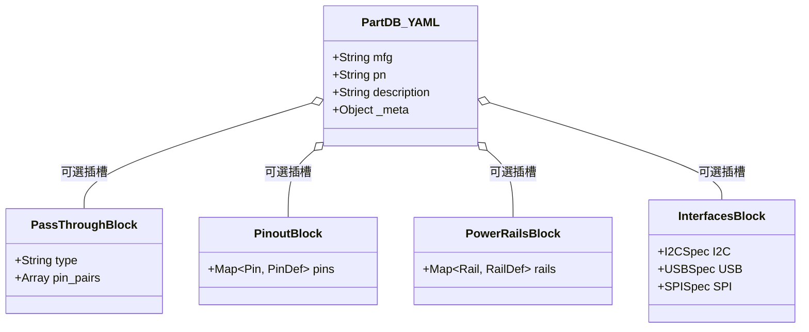

# PartDB 零件規格庫架構與全景 Schema 設計指南 (2026 現代 EDA 規範)

## 1. 核心定位與設計哲學 (Core Philosophy & Architecture)

在現代電子設計自動化 (EDA) 與 AI 輔助硬體設計 (AI-Assisted Hardware Engineering) 系統中，傳統將「零件規格」、「引腳特性」與「檢查演算法」混雜在單一程式碼中的做法已被全面淘汰。

DesignShield 確立 **「數據與邏輯解耦 (Data-Logic Separation)」** 的最高原則：
* **PartDB 嚴格定位為「規格真相庫 (Datasheet Truth & Physical Constraints)」：**
  * 只記錄客觀的物理特徵、原廠規格邊界與電氣要求（如耐壓、TVS 防護需求、最小去耦電容、I2C 上拉阻值範圍、引腳直通導通等）。
  * 絕不包含任何控制流程代碼、檢查動詞 (check, assert) 或報錯字串。
* **Rule Engine 嚴格定位為「審計評估者 (Audit & Evaluation Engine)」：**
  * 負責執行圖論演算法，由電路圖中尋找實體配置，並動態自 PartDB 查表比對。
  * **達成效益:** 1 支通用 DRC 規則（例如通用去耦電容檢查 `decoupling_cap_check.py` 或 I2C 阻值檢查 `i2c_compliance_check.py`），即可動態服務 10,000 顆不同型號的晶片，徹底終結針對個別晶片寫重複規則腳本的維護災難。

---

## 2. 儲存組織與 GitOps 協同模型 (Physical Storage Organization)

為適應現代 GitOps、多人團隊並行開發以及 LLM Agent 自動化建庫，PartDB 採用 **「一 Part 一 YAML + 領域分類子目錄」** 組織結構：

```
patterns/partdb/
├── schema/                                 # 模組化 JSON Schema 驗證契約
│   ├── schema_part.json                    # 根 Schema (Base + 特徵插槽引用)
│   ├── schema_pass_through.json            # 穿透與導通特性 Schema
│   ├── schema_pinout.json                  # 引腳矩陣與電氣約束 Schema
│   ├── schema_power_rails.json             # 供電域與去耦約束 Schema
│   ├── schema_i2c.json                     # I2C 介面特規 Schema
│   └── schema_usb.json                     # USB 介面特規 Schema (擴充)
└── data/                                   # 零件實體 YAML 資料庫
    ├── ics/                                # 積體電路 (MCU, PMIC, PHY, LevelShifter)
    │   ├── STM32F405.yaml
    │   └── TXS0102.yaml
    ├── passives/                           # 被動與排件 (Choke, Resistor Array, CMC)
    │   ├── ACM2012.yaml
    │   └── EXB28V.yaml
    ├── discrete/                           # 分離元件 (TVS, MOSFET, Diode)
    │   └── ESD9B5.yaml
    └── connectors/                         # 連接器與插座
        └── TYPEC_16PIN.yaml
```

### 架構優勢：
1. **零 Git 衝突 (Zero Merge Conflict):** 多位工程師或多個 LLM Agent 同時貢獻或更新零件規格時，各自只變更獨立檔案，絕不互相阻塞。
2. **LLM Context Window 極致精簡:** Agent 進行特定晶片維護時，只需加載數十行 YAML，大幅降低 Token 消耗並杜絕長文本幻覺。
3. **極速增量快取 (Incremental Ingestion):** 系統啟動或熱重載時僅需檢索更新的 YAML 檔案，毫秒級完成快取更新。

---

## 3. 模組化特徵插槽架構 (Faceted Feature Blocks Schema)

為了解決不同元件資訊內容差異極大（如阻容只有穿透映射，MCU 擁有複雜 pinout、多組通訊介面與供電域）的痛點，Schema 採用 **「基底規格 (Base Profile) + 特徵插槽 (Feature Blocks)」** 模型：



### 3.1 共通基座規格 (Base Profile - 必填)
所有元件檔案必須包含以下核心中繼資料：
* `mfg`: 零件原廠製造商簡稱代碼 (如 `"ST"`, `"TI"`, `"TDK"`，與線路 XML Mfg 屬性同步)
* `pn`: 零件型號 (Part Number, 唯一鍵值，如 `"STM32F405"`)
* `description`: 零件規格簡介
* `_meta`: 頂層規格書出處 (PDF 檔名、頁碼與摘錄)

*(架構備註: 系統落實特徵導向原則 Trait-Based Design，線路元件分類完全由 Level 1 負責；PartDB 聚焦於提供物理規格事實，不定義冗餘的名詞分類，元件能力直接由特徵插槽體現。)*

### 3.2 宣告式特徵插槽 (Feature Blocks - 隨需選用)
根據零件的物理實體，自由組合以下特徵塊，未使用的區塊直接省略，互不干擾：

1. **`pass_through` (穿透導通插槽):**
   * 適用於共模扼流圈、排阻、類比多工器、電平轉換晶片、0Ω 跳線。
   * 定義 `pin_pairs`（如 `[["1", "4"], ["2", "3"]]`）與導通方向 (`bidirectional` / `forward`)。
2. **`pinout` (引腳矩陣電氣約束插槽):**
   * 以 Pin 號或名稱為單元，定義：
     * `name`: 引腳訊號名稱 (如 `"VBUS"`, `"PA9"`)
     * `type`: 引腳電氣類型 (`"power_in"`, `"ground"`, `"io"`, `"analog"`, `"passive"`)
     * `voltage_max_v` / `voltage_min_v`: 引腳耐壓容限
     * `requires_esd`: 是否強制要求 TVS/ESD 保護元件 (`true`/`false`)
     * `pullup`: 結構化外部上拉約束 (`required`, `range_ohms: [min, max]`, `target_rail: "VDD"`, `package`)
     * `pulldown`: 結構化外部下拉約束 (`required`, `range_ohms: [min, max]`, `target_rail: "GND"`)
     * `series_resistor`: 訊號線串聯匹配/阻尼/限流電阻 (`required`, `range_ohms: [22, 27]`, `package: "0402"`)
     * `gnd_capacitor`: 專屬對地濾波旁路電容 (`required`, `min_cap_uf`, `max_cap_uf`, `voltage_rating_min_v`)
     * `decoupling`: 該引腳關聯之最小去耦電容容值 (`min_cap_uf`)
3. **`power_rails` (供電域與多階去耦插槽):**
   * 針對 IC 主供電軌（如 `VDD`, `VCC`, `AVDD`, `VBAT`）：
     * `nominal_voltage_v`: 建議工作電壓
     * `voltage_range_v`: 工作電壓容限範圍 `[min, max]`
     * `decoupling_capacitors`: 結構化多階去耦電容計數清單 (支援 `capacitance_uf`, `min_count`, `package`, `placement`)
     * `min_decoupling_caps_uf`: 傳統單純容值組合清單 (向下相容，每項代表 1 顆)
     * `max_ripple_mv`: 最大允許電源紋波
4. **`interfaces` (通訊介面特規插槽):**
   * 包含 `I2C`, `USB`, `SPI`, `CAN` 等特定協定硬體約束：
     * I2C: `pullup_range_ohms: [2000, 10000]`, `forbid_gnd_capacitor: true`, `max_bus_capacitance_pf: 400`
     * USB: `differential_impedance_ohms: 90`, `requires_cmc: true`, `esd_max_capacitance_pf: 0.5`
     * SPI: `max_freq_mhz: 50`, `requires_damping_resistor: false`

---

## 4. 階層式溯源資料模型 (Hierarchical Traceability)

為了杜絕 AI 抽取建庫時的幻覺，並在 DRC 違規報告中提供原廠鐵證，溯源資料 (`_meta`) 採階層式設計：
* **頂層 `_meta`:** 記錄整份零件的主要規格書檔案（如 `STM32F405_Datasheet.pdf`）。
* **區塊級 `_meta` (可選覆寫):** 當特定介面或引腳規範來自特定章節、應用筆記 (Application Note) 或特定規格頁時，允許在該區塊內直接覆寫 `page` 與 `excerpt`。

DRC 規則在產出違規卡片時，可精確將原廠手冊之頁碼與引用原文呈現在 UI 面板上，工程師點擊即可對照確認。

---

## 5. 完整全功能 YAML 示範 (Comprehensive Reference Example)

### 檔案路徑: `patterns/partdb/data/ics/ST_STM32F405.yaml`

```yaml
# PartDB 零件規格定義
mfg: "ST"
pn: "STM32F405"
description: "Arm Cortex-M4 32-bit MCU+FPU, 168MHz, 1MB Flash, USB OTG HS/FS"

# 頂層規格書出處
_meta:
  evidence: "STM32F405_Datasheet_Rev4.pdf"
  page: 1
  excerpt: "High-performance foundation line, ARM Cortex-M4 core with DSP and FPU."

# 特徵區塊 1: 供電軌規格
power_rails:
  VDD:
    nominal_voltage_v: 3.3
    voltage_range_v: [1.8, 3.6]
    min_decoupling_caps_uf: [0.1, 4.7]
    description: "Main digital power supply"
  VBAT:
    nominal_voltage_v: 3.0
    voltage_range_v: [1.65, 3.6]
    min_decoupling_caps_uf: [0.1]
    description: "Backup battery power supply"

# 特徵區塊 2: 關鍵引腳電氣約束 (Pinout Matrix)
pinout:
  "PA9":
    name: "USB_OTG_FS_VBUS"
    type: "power_in"
    voltage_max_v: 5.5
    requires_esd: true # 宣告需要 TVS 靜電保護
    _meta:
      page: 68
      excerpt: "PA9 can be used as VBUS sense. Dedicated ESD protection is strongly recommended."
  "NRST":
    name: "NRST"
    type: "input"
    voltage_range_v: [0.0, 3.6]
    requires_pullup: true # 內部雖有弱上拉，建議外部配置 10k
    decoupling:
      min_cap_uf: 0.1
  "OSC_IN":
    name: "OSC_IN"
    type: "analog"
    voltage_max_v: 3.6

# 特徵區塊 3: 匯流排介面電氣特規
interfaces:
  I2C:
    requires_series_resistor: false
    forbid_gnd_capacitor: true
    pullup_range_ohms: [2000, 10000]
    max_bus_capacitance_pf: 400
    _meta:
      page: 45
      excerpt: "In Fast-mode Plus, capacitive load <= 100pF. Avoid ground capacitors on SCL/SDA."
  USB:
    requires_esd_protection: true
    differential_impedance_ohms: 90
    _meta:
      page: 121
      excerpt: "USB 2.0 full-speed requires 90-ohm differential trace impedance and low-capacitance ESD array."
```

---

## 6. 結論與演進路徑 (Roadmap)

本架構建立了一套完全解耦、由數據驅動的現代 EDA 零件規格標準：
1. **人類友好:** 模組化 YAML 結構直觀清晰，符合硬體工程師閱讀習慣。
2. **AI 友好:** Pinout 表格與階層式 `_meta` 直接貼合 LLM 閱讀 Datasheet 時的段落理解結構。
3. **引擎友好:** 統一經由 `schema_part.json` 與各特徵子 Schema 嚴格把關，支援 Pre-hydration 預注入圖譜，提供 $O(1)$ 常數時間檢索。
