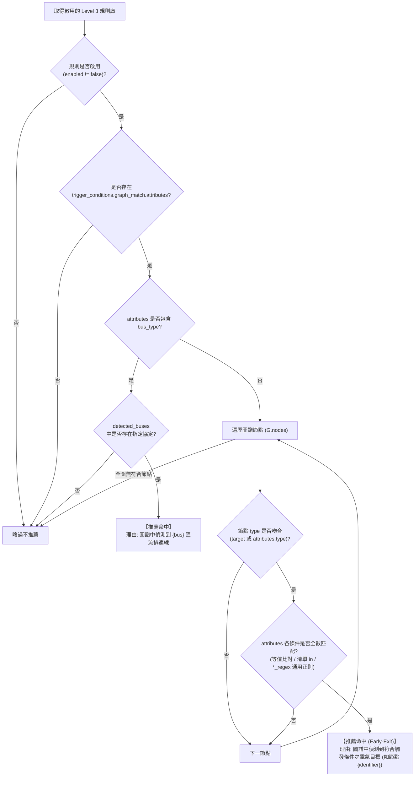

# DesignShield Level 3 DRC 設計規則驗證手冊 (Design Rule Check Guide)

本手冊為 DesignShield 系統 **Level 3 設計規則審計 (DRC Validation)** 之正式規格文件。
所有 DRC 規則均存放於 `patterns/level3_rules/` 目錄，以宣告式 YAML (IaC) 定義，並支援就近同檔名之 Python 伴生腳本執行深度拓撲與規格比對。

> [!TIP]
> 快速建立新 DRC 規則：可直接複製官方標準範本：
> - 規則定義範本：[`patterns/level3_rules/_template.yaml`](file:///home/gaven/DesignShield/patterns/level3_rules/_template.yaml)
> - 伴生腳本範本：[`patterns/level3_rules/_template.py`](file:///home/gaven/DesignShield/patterns/level3_rules/_template.py)
> 所有以底線 `_` 開頭之檔案會被引擎自動略過。

---

## 1. 核心機制與設計哲學

1. **職責邊界 (Scope & Responsibility):**
   - 針對電路網段 (`net`) 或元件節點 (`component`) 執行深度硬體規格驗證。
   - 涵蓋信號完整性 (Signal Integrity)、電源降額 (Power Derating)、短路防護 (Power-Ground Short)、差分極性 (P/N Swap)、差分通道導通性 (Differential Channel Continuity) 等關鍵硬體檢查。
2. **伴生腳本零寫死自動探索 (Zero-Hardcoding Companion Script Discovery):**
   - 規則 YAML 與其伴生 Python 腳本**同目錄同名成對存放**（例如 `pn_swap_check.yaml` 與 `pn_swap_check.py`）。
   - 執行引擎優先依檔案相對路徑推導同名腳本，YAML 中之 `script_path` 欄位**可直接省略**。資料夾重構或搬移時絕不斷線。
3. **真實資料審計原則 (Real-Data Audit Principle):**
   - 當規則或伴生腳本需要查詢 PartDB 零件規格但資料庫中無該料號時，**嚴禁偽造假資料或猜測引腳特性**。
   - 腳本應回傳 `RuleSkipped` 標記為資料缺失（UI 以灰色邊條提示），待工程師補充真實 PartDB 資料後重新審計。
4. **全自動遞迴探索 (Recursive Auto-Discovery):**
   - 引擎使用 `os.walk` 遞迴掃描 `patterns/level3_rules/` 下**所有子目錄**。
   - 工程師可自由依檢驗領域劃分子資料夾（如 `interfaces/`, `power/`, `safety/`, `high_speed/` 等），新規則與伴生腳本即放即用。
5. **動態推薦與真實狀態原則 (Dynamic Recommendation & Truth-First):**
   - 輕量預先分析引擎掃描圖譜特徵，100% 依據規則宣告之 `trigger_conditions` 動態推薦合適規則。
   - 若電路中無符合之電氣特徵，如實回傳空推薦清單 `[]`，**嚴禁任何硬編碼保底假數據**。

---

## 2. 目錄架構建議

官方推薦的一級子目錄組織架構如下：

```text
patterns/level3_rules/
├── _template.yaml          # 官方規則定義範本 (引擎自動略過)
├── _template.py            # 官方伴生腳本範本 (引擎自動略過)
├── tags.schema.json        # 規則標籤白名單 Schema
├── README.md               # 本開發手冊
├── interfaces/             # 介面協定與通訊匯流排 DRC
│   ├── differential_channel_continuity_check.yaml
│   ├── differential_channel_continuity_check.py
│   ├── i2c_pullup_existence.yaml
│   ├── i2c_pullup_existence.py
│   ├── i2c_stm32_dynamic.yaml
│   ├── i2c_stm32_dynamic.py
│   ├── level_shift_validation.yaml
│   ├── sd_interface_mode.yaml
│   ├── pn_swap_check.yaml
│   └── pn_swap_check.py
└── power/                  # 電源域、降額與去耦電容 DRC
    ├── decoupling_existence.yaml
    ├── power_derating.yaml
    ├── power_ground_short.yaml
    └── power_sequence_compatibility.yaml
```

---

## 3. 規則 YAML 綱要 (`Level3Rule`)

每個 Level 3 規則檔案包含以下頂層欄位：

| 欄位名稱 | 型別 | 必填 | 說明 |
| :--- | :--- | :---: | :--- |
| `name` | `string` | **是** | 規則唯一識別碼，必須符合小寫蛇形 (`snake_case`) |
| `enabled` | `boolean` | 否 | 是否啟用該規則 (預設 `true`) |
| `description` | `string` | 否 | 規則中文說明與工程檢驗目標 |
| `tags` | `list` | **是** | 規則標籤清單，每項標籤必須於 `tags.schema.json` 白名單中定義 |
| `severity` | `string` | **是** | 違規嚴重度：`"Fatal"`, `"Error"`, `"Warning"`, `"Info"` |
| `trigger_conditions` | `object` | **是** | 觸發比對條件，定義何種圖論節點觸發此規則審計 |
| `check_logic` | `list` | **是** | 檢驗邏輯步驟清單 (`python_script`, `topology_check` 或 `llm_agent`) |

---

## 4. 觸發條件 (`trigger_conditions`)

`trigger_conditions` 是 Level 3 規則的核心調度依據，在系統生命週期中具備**雙重關鍵職責**：
1. **預先分析與動態規則推薦 (Pre-analysis & Dynamic Recommendation)**：
   電路圖上傳並完成圖譜構建後，輕量預先分析引擎掃描全圖，判斷電路是否具備該規則欲檢驗之電氣特徵；若符合則推薦該規則給工程師，於前端 UI 預設自動勾選並提供具體的推薦理由。
2. **正式執行與受測目標實例注入 (Execution Target Injection)**：
   正式啟動 DRC 審計時，引擎依此條件過濾出圖譜中所有符合之節點實例，自動平行生成獨立的檢驗任務，並將該節點實例指標動態注入給 `${context.target}`。

### 4.1 YAML 綱要與語法範例

```yaml
trigger_conditions:
  graph_match:
    attributes:
      type: "net"                            # [必填] 節點類型: "net" (網路) 或 "component" (元件)
      # --- 當 type 為 "net" 時的常見屬性 (由 Level 2 拓撲引擎與網路分類器標註) ---
      bus_type: "I2C"                        # 匯流排協定: 支援字串 (如 "I2C") 或清單 (如 ["USB2", "USB3"])
      net_type: "Differential"               # 網路類型 (如 "Differential", "Single-Ended")
      diff_polarity: "P"                     # 差分極性 ("P" 或 "N")
      is_power: true                         # 是否為電源軌
      is_ground: true                        # 是否為接地軌
      is_bus: true                           # 是否為匯流排連線
      net_name_regex: "(?i).*SD_.*"          # [選填] 網路名稱正規表達式 (統一置於 attributes 內)
      # --- 當 type 為 "component" 時的常見屬性 (由 Level 1 元件分類器標註) ---
      # category: "IC"                       # 元件主類別 (如 "IC", "Passive", "Connector", "Discrete")
      # sub_category: "Capacitor"            # 元件子類別 (如 "Capacitor", "Resistor", "Inductor")
      # is_electrical: true                  # 是否為具備電氣功能之實體元件
      # mfg_pn_regex: "(?i)^LSF0102.*"       # [選填] 零件料號正規表達式 (支援前綴、後綴或特定型號篩選)
```

### 4.2 欄位詳細規格

| 欄位路徑 | 型別 | 必填 | 說明與比對行為 |
| :--- | :--- | :---: | :--- |
| `graph_match.attributes.type` | `string` | **是** | 目標節點類型，值必須為 `"net"`（網路）或 `"component"`（元件）。 |
| `graph_match.attributes.bus_type` | `string` \| `list` | 否 | 匯流排協定。若宣告此欄位，預先分析引擎會啟動**協定快篩**，直接比對電路在 Level 2 階段識別出的 `detected_buses` 集合；支援單一協定（如 `"I2C"`）或陣列（如 `["USB2", "USB3"]`）。 |
| `graph_match.attributes.<attr>` | `any` \| `list` | 否 | 圖論節點的各項屬性（如 `category`, `sub_category`, `is_electrical`, `is_power`, `is_ground`, `net_type`, `diff_polarity` 等）。支援純量完全匹配（`val == v`）或清單成員包含（`val in v`）。 |
| `graph_match.attributes.<field>_regex` | `string` | 否 | **通用屬性正則篩選器**。任何以 `_regex` 結尾之欄位，引擎自動剝除後綴比對原節點屬性（例如 `net_name_regex` 比對 `net_name`、`mfg_pn_regex` 比對 `mfg_pn`、`part_value_regex` 比對 `part_value`）。節點若無該屬性則以空字串進入比對。 |

> [!WARNING]
> **廢除外層正則宣告政策**：原外層之 `graph_match.net_name_regex` 已全面廢除並移除支援。所有正則條件一律強制收攏於 `graph_match.attributes` 內。若寫在外層，規則校驗器 (`validate_rules.py`) 將直接報錯阻擋。

### 4.3 條件邏輯運算規則 (AND vs OR)

1. **單一根鍵收攏 (Single Root Key):**
   - `trigger_conditions` 統一僅支援 `graph_match`，其底下僅允許 `attributes` 一個容器字典。所有目標特徵篩選條件 100% 收攏於 `attributes` 內。
2. **跨屬性欄位之間為「AND (且)」:**
   - `attributes` 下所列出的各項條件（如 `type: "net"`, `net_type: "Differential"`, `diff_polarity: "P"`, `net_name_regex: "(?i).*_DP.*"`）必須**同時全部成立**，該節點才算命中。
3. **單一屬性若宣告陣列清單為「OR (或)」:**
   - 當單一屬性欄位的值定義為清單陣列時（例如 `bus_type: ["USB2", "USB3"]`），只要節點的該屬性值符合陣列中的**任一元素**即視為滿足該項條件。
4. **通用正則後綴機制 (`*_regex`):**
   - 支援任意節點屬性的正則匹配。例如：
     - `mfg_pn_regex: "(?i)^LSF0102.*"` 篩選 Texas Instruments LSF0102 系列電平轉換晶片。
     - `net_name_regex: "(?i).*(?:RESET|NRST).*"` 篩選復位相關網路。

---

## 5. 規則推薦原則與預先分析機制 (Rule Recommendation & Pre-analysis)

輕量預先分析引擎（[`backend/app/engine/pre_analyzer.py`](file:///home/gaven/DesignShield/backend/app/engine/pre_analyzer.py)）在電路解析為二分圖後即時執行，為工程師自動推導最合適的審計規則。

### 5.1 六大推薦原則 (Core Principles)

1. **零業務硬編碼 (Zero-Hardcoding):**
   - 預先分析引擎本體不包含任何針對特定規則名稱的 if-else 硬編碼判斷。
   - 所有推薦決策 100% 依據現存規則 YAML 中之 `trigger_conditions` 動態運算產生。
2. **真實狀態原則 (Truth-First / No-Fabrication):**
   - 若電路圖譜中完全無符合該規則觸發條件之特徵，系統如實回傳空清單 `[]`。
   - **嚴禁**任何硬編碼保底假數據或未經比對的盲目全選推薦。
3. **規則啟用優先 (Enabled-First):**
   - 規則必須具備 `enabled != false`，且未在資料庫 `RuleStatus` 中被停用。已停用之規則不參與推薦，前端亦將禁用勾選。
4. **兩階段動態比對 (Two-Stage Hierarchical Matching):**
   - **階段 A (匯流排協定快篩):** 若規則宣告包含 `bus_type`，直接比對電路在 Level 2 階段識別出的 `detected_buses` 集合（如 I2C, SPI, USB2, USB3 等），命中時推薦理由為：`"圖譜中偵測到 {bus} 匯流排連線"`。
   - **階段 B (圖譜節點屬性掃描):** 若無 `bus_type`，遍歷圖譜節點檢查 `type`、`attributes`（包含等值比對、清單包含與 `*_regex` 通用正則）是否完全吻合。
5. **早期退出與代表節點反饋 (Early-Exit & Sample Identifier):**
   - 預先分析旨在確認「是否存在適用標的」，只要在圖譜中偵測到**第 1 個滿足條件之節點**，引擎即認定命中並立即早退 (`break`)，確保預檢可在數百毫秒內完成。
   - 命中時提取代表節點識別碼（優先取 `ref_des`、`net_name` 或 node ID），推薦理由為：`"圖譜中偵測到符合觸發條件之電氣目標 (如節點 {identifier})"`。
6. **前端預設選取與徽章標註 (Frontend Auto-Selection & Badging):**
   - 任務預分析完成後，前端 [`RuleTreeSelector.vue`](file:///home/gaven/DesignShield/frontend/src/components/RuleTreeSelector.vue) 會將所有推薦規則**預設加入勾選清單 (`selectedRuleIds`)**，並自動展開對應分類資料夾。
   - 規則樹節點標註高亮推薦標籤，滑鼠移至標籤可檢視後端推導之推薦理由，並提供「僅推薦 ({n})」快速過濾按鈕。

### 5.2 推薦比對決策流程



### 5.3 現存規則推薦觸發實例對照

| 規則識別碼 (`name`) | 目標類型 | 觸發與推薦比對條件 (`trigger_conditions.graph_match.attributes`) | 推薦觸發依據與理由 |
| :--- | :--- | :--- | :--- |
| `i2c_pull_up_existence` | `net` | `bus_type: "I2C"` | 電路中存在 Level 2 識別出的 **I2C 匯流排** |
| `i2c_stm32_dynamic` | `net` | `bus_type: "I2C"` | 電路中存在 Level 2 識別出的 **I2C 匯流排** |
| `pn_swap_check` | `net` | `bus_type: ["USB2", "USB3"]`<br/>`net_type: "Differential"`<br/>`diff_polarity: "P"` | 電路中存在 **USB 高速差分對正極網路** |
| `differential_channel_continuity_check` | `net` | `net_type: "Differential"`<br/>`diff_polarity: "P"` | 電路中存在任意 **差分對正極網路** |
| `ic_decoupling_capacitor_existence` | `component` | `category: "IC"`<br/>`is_electrical: true` | 電路中存在 **具備電氣功能之 IC 晶片** |
| `power_capacitor_derating` | `component` | `sub_category: "Capacitor"` | 電路中存在 **電容元件** |
| `power_ground_short_fatal` | `net` | `is_power: true`<br/>`is_ground: true` | 電路中存在 **同時帶有電源與接地符號之異常網路** |
| `power_sequence_compatibility` | `net` | `net_name_regex: "(?i).*(?:RESET\|NRST\|PWR_EN\|POWER_GOOD).*"` | 網路名稱符合 **RESET / 供電致能 / 復位時序關鍵字** |
| `sd_interface_mode_reasoning` | `net` | `net_name_regex: "(?i).*SD_.*"` | 網路名稱符合 **SD 卡介面訊號關鍵字** |
| `level_shift_logic_validation` | `net` | `net_name_regex: "(?i).*(?:LEVEL\|SHIFT\|V1P8\|V3P3).*"` | 網路名稱符合 **電平轉換 / 跨電壓域關鍵字** |

---

## 6. 檢驗邏輯 (`check_logic`)

系統支援三大混合式檢驗架構 (Hybrid Evaluation Modes)：

### 6.1 模式 A: Python 伴生腳本 (`type: python_script`, 推薦)

適用複雜動態邏輯、端到端通道穿透追蹤、PartDB 查表或電氣參數量測：

```yaml
check_logic:
  - type: "python_script"
    # script_path 可直接省略，系統自動就近尋找同名 .py 伴生腳本
```

伴生腳本入口函式規範：

```python
def execute(
    context: RuleContext,
    graph_api: GraphAPI,
    part_db: PartDB,
    params: Dict[str, Any] = None
) -> Union[List[RuleViolation], RulePass, RuleSkipped, RuleResult]:
```

- **合格 (PASS):** 回傳 `RulePass(message=..., evidence=...)`，提供審計歷程追溯。
- **違規 (FAIL):** 回傳 `[RuleViolation(error_message=..., recommendation=..., severity=..., evidence=...)]`。
- **缺失跳過 (SKIPPED):** 回傳 `RuleSkipped(message=..., evidence=...)`。

### 6.2 模式 B: 宣告式拓撲斷言 (`type: topology_check`)

適用單純靜態幾何或電氣規則，完全以 YAML 宣告：

```yaml
check_logic:
  - type: "topology_check"
    asserts:
      - condition: "capacitor_voltage_derating"
        node: "${context.target}"
        min_derating_ratio: 1.26
        error_message: "電容耐壓不足"
        recommendation: "建議選用額定耐壓較高之規格"
```

### 6.3 模式 C: 大語言模型智慧推理 (`type: llm_agent`)

適用語意複雜、引腳跨電壓域或架構合理性評估等高階工程推理：

```yaml
check_logic:
  type: "llm_agent"
  profile: "BALANCED"                        # 效能配置: FAST, BALANCED, DEEP
  context_extraction:
    keyword: "RESET"                         # 子圖關鍵字抽取範圍
  agent_prompt: >
    分析主控晶片與電源管理 IC (PMIC) 間之 RESET 與 POWER_GOOD 連接關係: ${context.subgraph}
    評估復位上拉電阻與去彈跳電容設計合理性。
  fallback_summary:
    error_message: ""
    recommendation: "RESET 引腳具備上拉與去彈跳電容，上電復位延遲符合時序規範。"
```

---

## 7. 本地校驗與快取重新編譯

每次新增或修改 Level 3 規則後，請執行統一校驗腳本：

```bash
# 執行規則 YAML、Tags 白名單與伴生腳本 AST 安全性審查
python3 scripts/validate_rules.py

# 呼叫 API 重新熱載入與快取預熱編譯
curl -X POST http://localhost:8000/api/v1/patterns/reload
```
