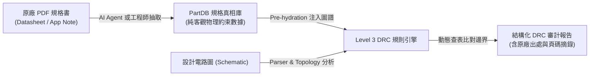
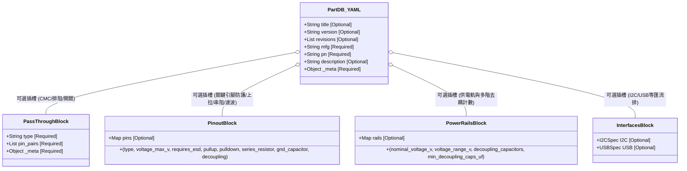

# PartDB 零件規格庫操作與維護手冊 (PartDB Operation & Maintenance Guide)

本手冊是 DesignShield **PartDB 零件規格庫** 的架構與維護指南，供硬體工程師、規則維護者交接，並作為未來 **AI Agent (LLM) 自動從 Datasheet 建庫時的最高行為準則 (System Prompt Guideline)**。

> 💡 **重要提示 (Quick Start):**
> 關於所有 YAML 欄位定義、型別約束、可選性標籤（`[Required]` 與 `[Optional]`）以及各特徵插槽的具體範例，**請直接參閱官方超級範本：[`patterns/partdb/_template.yaml`](file:///home/gaven/DesignShield/patterns/partdb/_template.yaml)**。範本內已附帶完整的繁體中文行內註解與欄位說明。

---

## 1. 核心定位與架構哲學 (Core Architecture & Philosophy)

DesignShield 確立 **「數據與邏輯絕對解耦 (Data-Logic Separation)」** 的最高架構原則：



* **PartDB 是「規格真相庫 (Datasheet Truth)」：**
  * 僅記錄客觀的硬體物理特徵、原廠邊界約束（如耐壓、TVS 防護要求、去耦電容容值、I2C 上拉阻值範圍、引腳穿透配對）。
  * 絕不包含任何控制流程程式碼、檢查動詞 (`assert`, `check`) 或報錯字串。
* **Rule Engine 是「審計評估者 (Audit Evaluator)」：**
  * 負責在電路圖圖譜中搜尋實體零件，並動態向 PartDB 查表比對。
  * **達成效益:** **1 套通用 DRC 規則即可服務 10,000 顆不同零件**，徹底避免為個別零件寫死專屬 Python 腳本的維護災難。

---

## 2. 實體目錄組織與檔案命名規範 (Organization & Naming Convention)

### 2.1 檔案命名標準
所有零件檔案必須命名為：
```text
<VendorCode>_<PartNumber>.yaml
```
* **VendorCode (原廠代碼):** 大寫英文字母（如 `TI`, `MURATA`, `NXP`, `ST`, `MICROCHIP` 等）。
* **PartNumber (核心料號):** 零件主型號（如 `TPS66994`, `DLM0NSN900HY2D`）。
* **範例:**
  * `TI_TPS66994.yaml` (德州儀器 USB Type-C & PD 控制晶片)
  * `MURATA_DLM0NSN900HY2D.yaml` (村田共模扼流圈)

### 2.2 目錄結構與自動遞迴掃描
引擎採用 **全自動遞迴掃描 (Recursive Auto-Discovery)**，`patterns/partdb/data/` 內任何子資料夾均會被自動檢索與快取。官方推薦的一級分類組織如下：

```text
patterns/partdb/
├── _template.yaml                  # 官方超級範本 (所有欄位細節與 [Optional] 說明都在此)
├── README.md                       # 本架構與維護手冊
├── schema/                         # 模組化 JSON Schema 驗證契約
│   ├── schema_part.json            # 根規格契約 (Base + 特徵插槽引用)
│   ├── schema_pinout.json          # 引腳矩陣電氣特徵契約
│   ├── schema_power_rails.json     # 供電域與去耦電容契約
│   ├── schema_pass_through.json    # 導通穿透引腳映射契約
│   ├── schema_i2c.json             # I2C 介面特規契約
│   └── schema_usb.json             # USB 介面特規契約
└── data/                           # 實體零件資料庫 (支援任意分類子目錄)
    ├── ics/                        # 積體電路 (PMIC, MCU, PHY, Sensor)
    │   └── TI_TPS66994.yaml
    ├── passives/                   # 被動元件與排件 (Choke, Resistor Array, CMC)
    │   └── MURATA_DLM0NSN900HY2D.yaml
    ├── discrete/                   # 分離元件 (TVS, MOSFET, Diode)
    └── connectors/                 # 連接器與插座
```

---

## 3. 模組化特徵插槽架構 (Faceted Feature Blocks Architecture)

為了解決不同元件資訊差異極大（如阻容只有穿透，MCU 擁有複雜 pinout、電源域與匯流排）的痛點，PartDB 採用 **「Base 核心基座 + 隨需特徵插槽」** 模型：



### 特徵插槽職責分工：
1. **Base 基本資料:** 規範原廠製造商代碼 (Mfg)、料號唯一鍵值 (PN)、零件簡介與頂層規格書出處 (_meta)。採特徵導向模型，不強制分類名詞（由 Level 1 線路規則分類），元件本質完全由特徵插槽定義。
2. **`power_rails` (供電軌插槽):** 規範工作電壓範圍、多階去耦電容計數清單 (`decoupling_capacitors` 支援顆數、封裝與擺放要求) 與相容簡寫清單。
3. **`pinout` (引腳矩陣插槽):** 定義關鍵引腳之電氣屬性、耐壓上限、TVS 防護要求，以及結構化外圍被動約束 (`pullup` / `pulldown` 阻值與電源軌、`series_resistor` 訊號串聯匹配阻尼、`gnd_capacitor` 對地濾波旁路)。
4. **`pass_through` (穿透導通插槽):** 定義內部物理通道直通對（CMC、排阻、類比多工開關、電平轉換晶片）。
5. **`interfaces` (通訊介面插槽):** 定義 I2C 上拉阻值範圍、USB 差分阻抗等標準通訊協定約束。

> 📖 **具體欄位細節：** 每個欄位之精確資料型別、預設值與 `[Required]` / `[Optional]` 規範，**請直接查閱 [`_template.yaml`](file:///home/gaven/DesignShield/patterns/partdb/_template.yaml)**。
> 💡 **修訂紀錄多行支援：** `revisions` 與頂層的 `description` 欄位全面支援 **多型格式**：
> 1. **YAML 多行塊 `|` (推薦)**：保留換行與 Markdown 條列格式，適合豐富文字。
> 2. **字串清單陣列 (`- "項目"`)**：結構化項目清單，利於 UI 時間軸依序渲染。
> 3. **傳統單行字串**：適合簡短修訂摘要。

---

## 4. 檢索 API 與雙層匹配機制 (Query API & Dual-Layer Matching)

SDK 查詢介面 (`PartDB.query`) 與核心引擎 (`PatternService.query_partdb`) 具備 **雙層智能檢索演算法**：

```python
from designshield.sdk import PartDB

part_db = PartDB()

# 情況 1: 精確指定製造商 (推薦，消除同料號不同廠歧義，對齊 XML 之 Mfg 屬性)
spec = part_db.query(pn="TXS0102", mfg="TI", interface="I2C")

# 情況 2: 線路圖未標註製造商 (純料號查詢)
# - 若庫中僅有 1 家製造商生產此料號，自動平滑命中
# - 若有多家製造商生產同料號 (如 TI_1117 vs AMS_1117)，系統記錄 Warning 並回傳預設製造商
spec = part_db.query(pn="STM32F405")
```

---

## 5. 新增零件標準作業流程 (SOP)

### 人類工程師新增步驟：
1. **複製超級範本:**
   ```bash
   cp patterns/partdb/_template.yaml patterns/partdb/data/ics/<Mfg>_<PartNumber>.yaml
   ```
2. **參閱範本註解填寫參數:**
   * 根據 [`_template.yaml`](file:///home/gaven/DesignShield/patterns/partdb/_template.yaml) 中的 `[Required]` 與 `[Optional]` 標註填寫資料。
   * 保留需要的特徵區塊（如 `pinout` 或 `pass_through`），刪除無關區塊。
   * 務必填寫 `_meta` 中的原廠規格書出處、頁碼與原文摘錄 (`excerpt`)。
3. **執行本地校驗:**
   ```bash
   backend/.venv/bin/python3 scripts/validate_rules.py
   ```
   校驗器將即時檢查命名規範、JSON Schema 契約與引腳配對。

---

## 6. AI Agent 自動建庫指引 (LLM Ingestion System Prompt)

當指派 AI Agent 閱讀原廠 PDF Datasheet 建立 PartDB 資料時，Agent 必須遵守以下規則：

1. **真實性第一 (Zero Hallucination):** 絕不可憑空猜測電壓或阻值。所有數值必須直接來自規格書之「Absolute Maximum Ratings」、「Recommended Operating Conditions」或「Pin Description」表格。
2. **階層式鐵證 (_meta):** 頂層 `_meta` 記錄主要 Datasheet 檔名；每個特殊特徵（如 `PA9` 要求 ESD 或 `I2C` 阻值範圍）必須附帶具體規格頁碼與原文摘錄 (`excerpt`)。
3. **以超級範本為唯一基準:** 嚴格以 [`patterns/partdb/_template.yaml`](file:///home/gaven/DesignShield/patterns/partdb/_template.yaml) 作為 Few-Shot 範本結構，嚴格遵守其 `[Required]` 與 `[Optional]` 約束。
